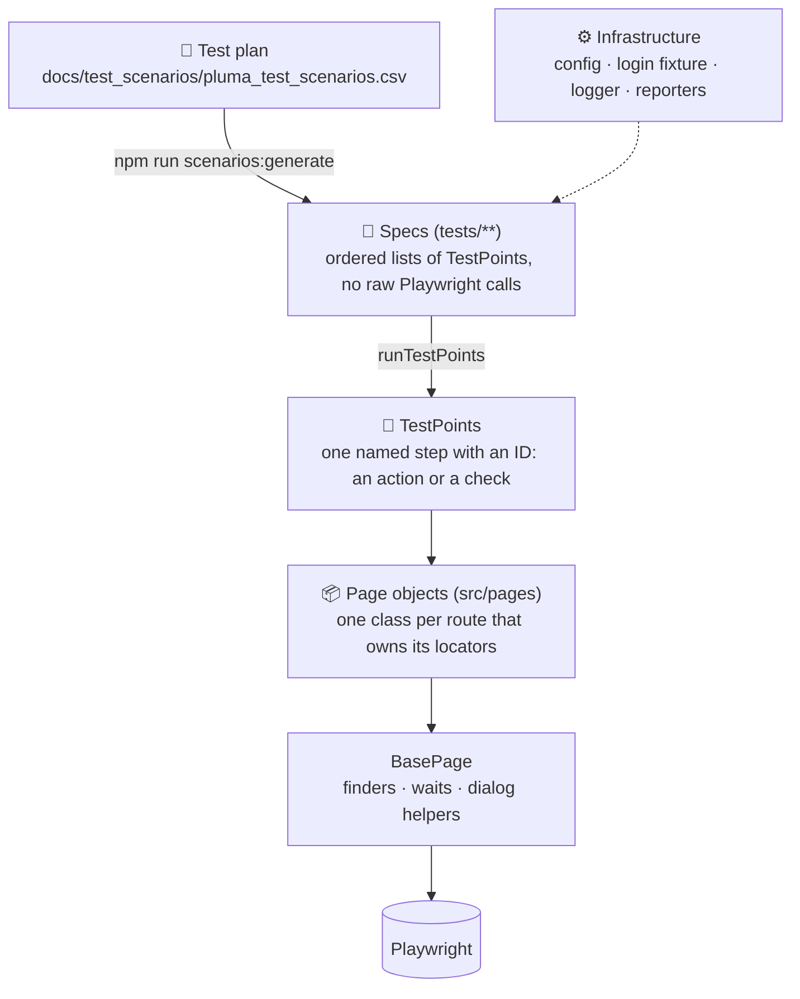

# Pluma E2E Test Automation — Playwright + TypeScript

[](https://playwright.dev)
[](https://www.typescriptlang.org)


An automated test suite for **[Pluma](https://app.pluma.ai)**, an AI content and SEO web app. It is built as
a real QA project would be: a layered architecture, test cases written as data, reports a manager can read,
and strict rules so it can run safely against a **live production account**.

> **Results:** 114 tests: 10 end-to-end business flows, 21 feature scenarios, every page and sidebar link,
> and the framework's own unit tests. All 114 pass in about 7 minutes, and each test leaves a Playwright trace you can replay.

---

## Table of contents

1. [What this project shows](#what-this-project-shows)
2. [Quick start](#quick-start)
3. [Architecture](#architecture)
4. [The TestPoint pattern](#the-testpoint-pattern)
5. [Test cases written as data (CSV → specs)](#test-cases-written-as-data-csv--specs)
6. [Test coverage](#test-coverage)
7. [Reports: what you get after a run](#reports-what-you-get-after-a-run)
8. [Testing safely against a live account](#testing-safely-against-a-live-account)
9. [Engineering challenges solved](#engineering-challenges-solved)
10. [Project structure](#project-structure)

---

## What this project shows

| Skill | Where to look |
|---|---|
| **Test architecture**: Page Object Model plus small reusable steps (TestPoints) | [`src/pages/`](src/pages), [`src/testpoint/`](src/testpoint) |
| **End-to-end testing**: create data, check it across views and reloads, clean up | [`src/pages/calendar.page.ts`](src/pages/calendar.page.ts), `E2E-01 … E2E-10` |
| **Data-driven tests**: scenarios written in a CSV test plan, with specs generated from it | [`docs/test_scenarios/`](docs/test_scenarios), [`scripts/split-scenarios.ts`](scripts/split-scenarios.ts) |
| **Reporting**: HTML, plus one JSON, one log and one Playwright trace per test case, and a Markdown summary | [`src/configuration/plumaReporter.ts`](src/configuration/plumaReporter.ts), [`src/testpoint/testCaseReport.ts`](src/testpoint/testCaseReport.ts) |
| **Robust locators** in an app with no `data-testid` attributes | [`src/pages/BasePage.ts`](src/pages/BasePage.ts) |
| **Tests for the framework itself** | [`tests/framework/`](tests/framework) |
| **Config and secrets**: YAML defaults overridden by `.env`; no credentials in the code | [`src/configuration/config.ts`](src/configuration/config.ts) |

---

## Quick start

**Requirements:** Node.js 18+ and an email/password Pluma account (not Google sign-in).

```bash
npm install
npx playwright install chromium
cp .env.example .env     # then set PLUMA_EMAIL and PLUMA_PASSWORD
```

```bash
npm run test:framework   # no login needed: framework unit tests and CSV checks (a few seconds)
npm run test:smoke       # fast check that login and the main pages work
npm run test:scenarios   # the 31 business scenarios, E2E-01 … E2E-10 included
npm test                 # the whole suite (114 tests, about 7 min)
npm run report           # open the HTML report of the latest run
npm run execution -- list   # every execution, with its result
```

| `.env` variable | Purpose | Default |
|---|---|---|
| `PLUMA_EMAIL`, `PLUMA_PASSWORD` | Test account credentials | (required) |
| `PLUMA_BASE_URL` | Application under test | `https://app.pluma.ai` |
| `PLUMA_HEADLESS` | `false` opens a visible browser | `true` |
| `PLUMA_SLOW_MO_MS` | Delay between actions, for demos | `0` |
| `PLUMA_TRACE` | Playwright trace of each test: `on`, `off`, `retain-on-failure`, `on-first-retry` | `on` |
| `PLUMA_VIDEO` | Video of each test (same values) | `off` |

---

## Architecture



The layers:

- **Specs** describe *what* is tested. They read like a test plan and contain no selectors.
- **TestPoints** are small steps with an ID, such as `TP-ACT-CALENDAR-09` (create a task). Many scenarios reuse them.
- **Page objects** hide *how* a page is driven: its locators, waits and quirks. A UI change is fixed in one place.
- **Infrastructure**: a worker-scoped fixture logs in **once** and saves the session. Each test then opens its own browser context from it, so every test gets its **own Playwright trace** without logging in again. Config is read from YAML and overridden by `.env`.

---

## The TestPoint pattern

A TestPoint is a reusable step with an ID. It records its own status, timing, URLs and error:

```ts
export class CalendarCreateTask extends TestPoint {
  constructor(label: string, status = "Draft", priority = "Medium", description = "") {
    super(actionId("CALENDAR", 9), `Create task "${qaName(label)}"`, async (page) => {
      await new CalendarPage(page).createTaskOnBoard(qaName(label), { status, priority, description });
    });
  }
}
```

A test is an ordered list of TestPoints. **Teardown steps always run**, even when a step fails:

```ts
test("E2E-01 Create a task and delete it", async ({ loggedInPage }) => {
  await runTestPoints(loggedInPage, [
    new CalendarCleanupQaData(),                        // TP-ACT-CALENDAR-08
    new CalendarCreateTask("E2E-01"),                   // TP-ACT-CALENDAR-09
    new CalendarAssertTaskInColumn("E2E-01", "Draft"),  // new tasks land in Draft
    new CalendarReloadBoard(),
    new CalendarAssertTaskInColumn("E2E-01", "Draft"),  // …and are saved on the server
    new CalendarDeleteTask("E2E-01"),
    new CalendarReloadBoard(),
    new CalendarAssertTaskAbsent("E2E-01"),             // …and are really deleted
  ], { teardown: [new CalendarCleanupQaData()] });
});
```

ID scheme: `TP-OPEN-<PAGE>` opens a page, `TP-BTN-<PAGE>-NN` checks a control, and `TP-ACT-<PAGE>-NN` is an action or check.
Each TestPoint appears as a step in the Playwright HTML report.

---

## Test cases written as data (CSV → specs)

The test plan [`pluma_test_scenarios.csv`](docs/test_scenarios/pluma_test_scenarios.csv) is the **single source of truth**.
It has one row per step, so a QA analyst can write or review scenarios without reading TypeScript:

```csv
scenario_id,domain,summary,step,testpoint_id,testpoint_class,args,expected_result,phase
E2E-01,End-to-end,Create a task and delete it,2,TP-ACT-CALENDAR-09,CalendarCreateTask,E2E-01,Task is created and its card appears,
E2E-01,End-to-end,Create a task and delete it,3,TP-ACT-CALENDAR-10,CalendarAssertTaskInColumn,E2E-01|Draft,New tasks land in Draft,
E2E-01,End-to-end,Create a task and delete it,10,TP-ACT-CALENDAR-08,CalendarCleanupQaData,,Nothing left behind,teardown
```

`npm run scenarios:generate` turns each scenario into `tests/scenarios/<ID>.spec.ts`, which is the spec shown above.
The generator **stops with an error** if a class doesn't exist or an ID in the CSV doesn't match the code.
A framework test fails if a generated spec is out of date with the CSV.

---

## Test coverage

| Suite | Tests | What it checks |
|---|---:|---|
| **End-to-end** (`E2E-01 … 10`) | 10 | Real business flows in the Calendar/task board (see below) |
| **Feature scenarios** | 21 | Dashboard, documents, Brand Voice, Topical Map, Calendar, LLM Rank, Pluma Art, Humanize, Link Network, Backlinks, Keywords, Templates, Settings, Workspace, Rewards |
| **Navigation** | 38 | Every page (24 routes) opened by URL, and every sidebar link |
| **Page inspection** | 27 | Every documented control of every page is visible |
| **Auth** | 3 | Login form, a wrong password is rejected, a valid login works |
| **Smoke** | 3 | Fast check of the main pages |
| **Framework** | 12 | TestPoint status, stop at first failure, teardown, JSON report, log files, CSV parser, generated specs up to date |

### The 10 end-to-end tests

| ID | What it proves |
|---|---|
| E2E-01 | A new task lands in **Draft** with priority **Medium**, survives a reload, and is really gone after Delete |
| E2E-02 | The status and priority chosen at creation decide the column and show in the task |
| E2E-03 | Editing the title and description is saved (checked after a reload) |
| E2E-04 | A task moves through the whole workflow: Draft → In Progress → In Review → Completed |
| E2E-05 | The task's **History** records "task created", "title changed" and "description changed" |
| E2E-06 | A comment is posted and is still there after a reload |
| E2E-07 | Search shows only the matching task and hides it for other text |
| E2E-08 | The same task shows the same data in the **Board**, **List** and **Summary** views (the Summary count goes up by exactly 1) |
| E2E-09 | A custom status column can hold a task and can be deleted |
| E2E-10 | Negative path: an empty title, or Cancel, saves nothing |

---

## Reports: what you get after a run

Each run writes to `reports/<timestamp>/`, and `reports/latest` always points to the newest run:

| Output | For whom | Content |
|---|---|---|
| `html/` | Developers | Playwright HTML report. Each TestPoint is a step, and every test has a **View trace** button |
| `artifacts/<test>/trace.zip` | Developers, QA | **Playwright trace of every test**: the same view as Playwright's UI mode (see below) |
| `summary.md` / `summary.json` | Managers, CI | One line per test with a link to its trace. Rewritten after **every** test, so even a stopped run has a summary |
| `testcases/<test>.json` | QA, dashboards | **One per test case**: every TestPoint with its status (`passed` / `failed` / `not-run`), timings, URLs, error and phase (`test` / `teardown`), plus the path of its trace |
| `logs/<test>.log` | Debugging | **One per test case**, with the same name as its JSON: each step with a timestamp, and a final `Result:` line |
| `results.json` | Tools | Playwright's full JSON report |

Example test case JSON:

```json
{
  "testCase": "E2E-01 Create a task and delete it",
  "scenarioId": "E2E-01",
  "result": "passed",
  "totals": { "testpoints": 10, "passed": 10, "failed": 0, "notRun": 0 },
  "testpoints": [
    { "step": 2, "id": "TP-ACT-CALENDAR-09", "description": "Create task \"QA-E2E E2E-01 22202255\"",
      "phase": "test", "execution": "passed", "durationMs": 2925,
      "urlBefore": "/app/calendar?view=board", "urlAfter": "/app/calendar?view=board" }
  ],
  "recordings": {
    "trace": "artifacts/scenarios-E2E-01-…-chromium/trace.zip",
    "viewTrace": "npx playwright show-trace reports/<run>/artifacts/scenarios-E2E-01-…-chromium/trace.zip"
  }
}
```

### Replaying a test in the Trace Viewer

Every test records a Playwright trace. Opening one gives the same screen as Playwright's UI mode, for a test that has already run:

- the actions, **grouped by TestPoint** (`TP-ACT-CALENDAR-09 Create task …`);
- a timeline you can scrub through;
- the DOM snapshot **before, during and after** each action, which you can inspect like a live page;
- the locator used, plus the console, network calls and source code of each step.

Ways to open a trace:

```bash
npm run report                                   # HTML report → open a test → "View trace"
npm run trace -- reports/latest/artifacts/<test>/trace.zip
```

You can also drop the `trace.zip` file on [trace.playwright.dev](https://trace.playwright.dev); it opens locally in the browser. To watch tests live instead, use `npm run test:ui`.

Example log:

```
2026-11-22T20:23:00.493Z [INFO] Running TestPoint TP-ACT-CALENDAR-08: Delete every "QA-E2E" task and status column left on the board
2026-11-22T20:23:03.314Z [INFO] TestPoint TP-ACT-CALENDAR-08 passed
2026-11-22T20:23:03.319Z [INFO] Running TestPoint TP-ACT-CALENDAR-09: Create task "QA-E2E E2E-01 22202255"
2026-11-22T20:23:06.244Z [INFO] TestPoint TP-ACT-CALENDAR-09 passed
…
Result: passed in 15.1s
```

### Exporting and importing a whole execution

An execution is one folder, `reports/<timestamp>/`, containing the HTML report (with its traces), the logs,
the JSON reports and the summary. It can be moved to another machine as **one file** and opened there
just like a local run, for example a run from CI, or a colleague's failing run:

```bash
npm run execution -- export                    # latest run → exports/pluma-execution-<run>.tar.gz
npm run execution -- export 2026-11-22_22-32-19 --out run.tar.gz
npm run execution -- import run.tar.gz         # → reports/<run>/ (or <run>_imported if it exists)
npm run execution -- import some/folder --name ci-build-42
npm run execution -- list                      # local and imported executions with their results
npm run execution -- open ci-build-42          # HTML report; each test has "View trace"
```

```
Execution                         Result    Tests  Passed  Failed  Source
2026-11-22_22-32-19 (latest)      passed      114     114       0  local
ci-build-42                       failed      114     112       2  imported
```

Imports accept `.tar.gz`, `.tgz`, `.zip`, or an execution folder. The exported file contains traces,
which hold the test account's session token, so share it only with people you trust.

---

## Testing safely against a live account

The suite runs against a **real account**, so it follows strict rules:

- **Outside the E2E tests, it doesn't change anything.** Buttons that would generate, save, send, delete, connect or pay are only checked for visibility. Dialogs are opened, filled, then closed with Cancel or Escape.
- **The E2E tests clean up after themselves.** Everything they create is named `QA-E2E <label> <run id>`, so runs never collide. Each test **starts** by removing leftovers from earlier runs, and **ends** with a teardown that always runs, even after a failure. After a full run the board is back to its original state.
- **No paid AI credits are used.** No generation is triggered.
- **No secrets are stored in the code.** Credentials come only from `.env`, which is git-ignored.
- **The password never appears in a trace.** The login runs in a browser context that isn't recorded. The login tests type the password, and a trace records typed text, so those tests have no trace. Traces still contain the session token in network requests, so `reports/` is git-ignored and should not be shared publicly.

---

## Engineering challenges solved

Pluma has **no `data-testid` attributes**, and its UI has several traps. Each one was found and fixed in the page objects, so specs never need to know about them:

| Problem | Solution |
|---|---|
| Buttons nested inside buttons with the **same accessible name** (strict-mode violations) | `nestedButton(name)` picks the inner one. It is used only where needed, because a global `.last()` broke other buttons |
| A task card's accessible name **includes its description**, so lookups by name broke after an edit | Cards are found by their title heading: `button:has(h4 = title)` |
| Text upper-cased only by **CSS** (`TOTAL ITEMS` is "Total items" in the DOM) | Case-insensitive regular expressions |
| "Create Task" **does nothing** while the Status field still shows "Loading..." | Wait until the field shows "Draft" before submitting |
| Comboboxes with **no accessible name** | Filter comboboxes by the text they show |
| A sidebar section that collapses **while the page is still rendering** | Wait for the link first, and expand the section only if needed |
| A log hook in a shared file **applied only to the first spec file** | Replaced by an automatic Playwright fixture: every test gets its own log |
| A saved Playwright session **logged the user out** in new contexts | Pluma keeps its token in `sessionStorage`, which `storageState()` doesn't save. It is saved separately and restored with an init script before the page loads |

Locators that still need a test id from the developers are marked **⚠** in the code.

---

## Project structure

```
.
├── docs/test_scenarios/pluma_test_scenarios.csv   # test plan: single source of truth
├── scripts/split-scenarios.ts                     # CSV → tests/scenarios/*.spec.ts generator
├── scripts/execution.ts                           # list / export / import / open a whole execution
├── src/
│   ├── configuration/    # config.yaml + .env, login, logger, report folders, custom reporter
│   ├── fixtures/auth.ts  # one login per worker, a traced logged-in page per test, per-test log
│   ├── navigation/       # sidebar component and navigation TestPoints
│   ├── pages/            # BasePage + one page object per route (24 routes)
│   ├── testpoint/        # TestPoint class, ID helpers, JSON test case report, QA data naming
│   └── catalog.ts        # every TestPoint a scenario can use
├── tests/
│   ├── auth/             # login tests (fresh, logged-out browser)
│   ├── scenarios/        # 31 generated scenario specs (E2E-01…10, DOC-01, CAL-01, …)
│   ├── framework/        # unit tests of the framework itself (no browser)
│   ├── navigation/       # every page by URL + every sidebar link
│   ├── smoke/
│   └── testpoints/       # registry checks + live inspection of every page
├── pluma-locators.md     # locator inventory collected from the app
└── playwright.config.ts
```

### Adding a page

1. Create `src/pages/<name>.page.ts`: a class that extends `BasePage`, with `static path`, `static key`, its locators and its TestPoints.
2. Export it from `src/pages/index.ts` and add it to `PAGE_INVENTORY`.
3. Run `npm run test:framework`, which checks IDs and structure.

---

**Tech stack:** Playwright · TypeScript (strict) · Node.js · YAML config · dotenv · tsx
